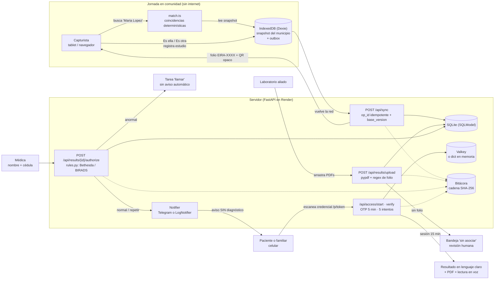

# Arquitectura · Hilo Rosa

> Prototipo de hackathon (Vibeathon Nerdearla México 2026, Reto 4 sobre la base del Reto 1). Solo datos ficticios.
> Qué está construido y qué es simulado: [`IMPLEMENTADO_VS_SIMULADO.md`](IMPLEMENTADO_VS_SIMULADO.md).

## En una frase
Una sola app web (FastAPI + React) que deja a la capturista de EIRA registrar pacientes **sin internet**, sincroniza al volver la red, recibe los PDFs del laboratorio, los asocia por folio, pide autorización de la médica con su cédula, avisa **sin diagnóstico** y deja que la paciente o su persona de confianza abra el resultado con **QR + fecha de nacimiento + código de 6 dígitos**.

## Flujo de punta a punta

## Componentes
| Capa | Pieza | Qué hace | Tarea |
|---|---|---|---|
| Web (offline) | `web/src/lib/db.ts`, `outbox.ts` | Snapshot del municipio y cola de operaciones en IndexedDB (Dexie) | HR-007 |
| Web (offline) | `web/src/lib/match.ts` | Normaliza nombres y calcula `score 0–100` con `razones`; nunca fusiona | HR-004 |
| Web (offline) | `web/public/sw.js` | Service worker: la app abre sin red tras la primera visita | HR-007 |
| API | `app/routers/jornadas.py`, `sync.py` | Snapshot, sync idempotente, folio `EIRA-XXXX` y credencial QR | HR-006 |
| API | `app/routers/results.py` | Carga de PDFs y asociación por folio exacto o manual | HR-008 |
| API | `app/routers/review.py`, `app/services/notifier.py` | Autorización con cédula, aviso sin diagnóstico | HR-009 |
| API | `app/services/rules.py` | Tabla de reglas Bethesda / BIRADS / conducta → clasificación, seguimiento y texto claro | HR-005 |
| API | `app/services/audit.py` | Bitácora con `prev_hash` / `hash` SHA-256 y `verify()` | HR-005 |
| API | `app/routers/access.py`, `app/services/otp.py` | QR → fecha de nacimiento → OTP → sesión | HR-010 |
| Datos | `app/services/store.py` | SQLite vía SQLModel | HR-001 |

Contrato compartido: Pydantic en `app/schemas/` y tipos espejo en `web/src/api/types.ts`. Estados de un resultado: `pendiente_asociar → por_revisar → autorizado → notificado → visto`.

## Tecnologías y dependencias
| Área | Elección | Por qué |
|---|---|---|
| Backend | Python, FastAPI, Uvicorn, pydantic-settings | Rápido de escribir, contrato tipado, OpenAPI gratis |
| Persistencia | SQLite + SQLModel | Cero infraestructura para la demo; migrable a PostgreSQL |
| Matching servidor | rapidfuzz | `token_set_ratio` probado; el cliente replica la lógica en `match.ts` |
| PDFs | pypdf (leer), reportlab (generar PDFs sintéticos) | Extraer el folio del texto del PDF |
| QR | qrcode[pil] (servidor), qrcode.react (pantalla), html5-qrcode (escaneo en navegador) | Sin app nativa que instalar |
| OTP / TTL | redis-py contra Valkey, con dict en memoria de respaldo | Expiración nativa; la demo no depende de la red |
| Avisos | Telegram Bot API vía httpx, con `LogNotifier` de respaldo | Bot de la hackathon sin infraestructura propia; el respaldo muestra el "SMS simulado" en pantalla |
| Frontend | Vite, React, TypeScript, react-router-dom, Tailwind CSS v4, motion | SPA ligera servida por el mismo FastAPI (`web/dist`) |
| Offline | Dexie (IndexedDB) + service worker | Funciona en el navegador de la tablet, sin instalar nada |
| Despliegue | Docker + `render.yaml` en Render | Un solo servicio: API + web estática |
| Pruebas | pytest, node --test, Playwright | Cada tarea tiene un comando de verificación |
| Opcional (P2) | Claude (`claude-sonnet-5-5`) para suavizar la redacción | Solo sugerencia; la médica edita y autoriza. Fallback: plantillas fijas |

## Decisiones de diseño
1. **Matching determinístico y explicable, nunca fusión automática.** Normalización (sin acentos, "Ma."→María, quita "de/del/la", apellidos en cualquier orden) + token-set ratio + reglas de fecha (exacta o día/mes invertido), teléfono y municipio. Umbral ≥85 = "posible coincidencia". La capturista siempre decide con **Es ella / Es otra**. Un duplicado se corrige; una fusión equivocada mezcla expedientes clínicos.
2. **Offline-first con outbox idempotente.** Cada operación lleva `op_id` (reintentar no duplica) y `base_version` (si el servidor cambió, se reporta conflicto en vez de sobrescribir). Sin CRDT: una jornada = pocos dispositivos y conflictos raros.
3. **El QR no contiene datos.** Es un token opaco y revocable. Perder la credencial no expone a nadie: sin fecha de nacimiento y sin el código al teléfono registrado no se abre nada.
4. **Acceso sin cuenta ni contraseña: token + fecha de nacimiento + OTP.** OTP de 6 dígitos, TTL 5 min, 5 intentos; sesión de 15 min. Pensado para celular compartido y personas que no usan correo.
5. **Aviso sin diagnóstico.** El mensaje solo dice que hay un resultado listo. Un resultado anormal **no** se avisa por mensaje: crea la tarea "llamar" para que EIRA hable con la paciente.
6. **Reglas clínicas en código, no en el LLM.** Clasificación, seguimiento, texto claro, permisos y score de coincidencia son determinísticos y probados. El LLM es opcional y solo propone redacción.
7. **Bitácora con cadena de hashes SHA-256.** Cada evento guarda el hash del anterior; `verify()` detecta un registro alterado y la pantalla muestra "integridad ✅".
8. **Asociación de PDF por folio exacto.** Si el folio no aparece en el texto, el PDF va a la bandeja "sin asociar" para revisión humana; nunca se adivina por nombre (el problema actual con WhatsApp).
9. **Misma numeración que el papel.** La captura de mama usa los campos 18–24 del formato real de EIRA para que la capturista copie campo por campo.
10. **Cada servicio externo tiene respaldo local** (Telegram → LogNotifier, Valkey → memoria, cámara → link `/p/<token>`), para que la demo y una jornada sin red no se caigan.
